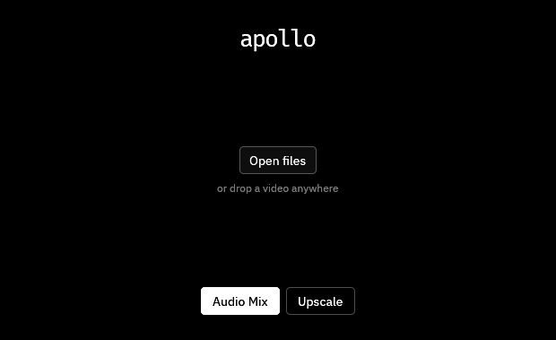

  

  A native Windows utility for focused media workflows.

  <a href="#download-apollo">Download</a>
  ·
  <a href="#features">Features</a>
  ·
  <a href="#requirements">Requirements</a>
  ·
  <a href="#project-documentation">Documentation</a>
  ·
  <a href="CHANGELOG.md">Changelog</a>

  

## About Apollo

Apollo is a small native desktop media utility for audio mixing, video upscaling, stream-copy remuxing, audio extraction, and timestamped frame capture.

## Download Apollo

- **[Windows EXE installer](https://github.com/TommyMoonn/apollo/releases/latest/download/Apollo-Setup-x64.exe)** (recommended)
- **[Portable Windows ZIP](https://github.com/TommyMoonn/apollo/releases/latest/download/Apollo-windows-x64.zip)**

The installer registers Apollo for the current Windows user, creates a Start Menu shortcut, and provides normal Windows uninstall behavior. The portable ZIP does not register or install Apollo.

Apollo v0.5.0 includes FFmpeg and FFprobe in both Windows packages, so no separate media-tool installation is needed. Keep the portable folder intact, including `licenses/`. Older releases, including v0.4.0, still require the tools on PATH; check the downloaded release version.

See the [latest release notes](https://github.com/TommyMoonn/apollo/releases/latest) or browse [all releases](https://github.com/TommyMoonn/apollo/releases).

## Features

- **Audio Mix** - choose the embedded audio tracks to keep, mix them into one AAC stream, and write MP4 or MKV output without re-encoding the video.
- **Video Upscale** - fit preset or custom boundaries while preserving the source aspect ratio, with H.264/H.265 output, CPU or NVIDIA encoding, and numeric quality controls.
- **Remux** - copy all compatible streams into MKV or MP4 without re-encoding, with incompatibilities reported before processing.
- **Audio Extract** - save one selected audio track as an original MKA copy, 256 kbps AAC, or lossless FLAC.
- **Frame Capture** - save one timestamped frame as lossless PNG or high-quality JPEG, then confirm the result with a bounded image preview.
- **Source workspace** - keep one source loaded while switching between media tools, or explicitly change or close it.
- **Output control** - edit the output filename, choose the destination, and return to the last-used source and output directories in native file dialogs.
- **Safe publication** - work is written to an owned temporary location and published only after successful completion; failed or cancelled work does not leave a misleading final file.
- **Responsive native interface** - the compact egui interface adapts across narrow, normal, wide, tall, and fullscreen windows while keeping idle and progress updates restrained.

## Requirements

- Windows x64.
- No separate FFmpeg installation is needed for the v0.5.0 Windows packages. They include CPU H.264 (`libx264`) and H.265 (`libx265`) encoders.
- Optional NVIDIA encoding requires `h264_nvenc` or `hevc_nvenc` plus a compatible NVIDIA GPU and driver. Apollo checks whether each encoder can actually run.

The pinned Windows x64 distribution is FFmpeg 7.0.2, Gyan build `7.0.2-essentials_build-www.gyan.dev`. Its tested NVIDIA baseline is driver **566.14** on an **RTX 3060 Laptop GPU**, with NVENC API **12.2**. This is a tested configuration, not a minimum-driver claim or a guarantee for every NVIDIA GPU. CPU workflows do not require NVIDIA hardware.

Apollo prefers the complete pair beside `Apollo.exe`. Only when both files are absent does it search PATH, which remains useful for development. A partial or invalid bundle is an error: restore the complete package, then use Retry. Apollo never mixes bundled and PATH tools.

See the [pinned manifest](distribution/media-tools.json), [build compatibility evidence](distribution/media-tools-acceptance.md), and [redistribution notices](THIRD_PARTY_NOTICES.md#bundled-ffmpeg-and-ffprobe).

## Upscale controls

- **Target:** choose 1440p, 4K, or 8K, or enter positive even Custom width and height boundaries. Presets adapt to source orientation; Custom uses the box exactly as entered. The calculated output fits inside it without cropping, padding, or stretching.
- **Encoder:** Auto uses NVIDIA NVENC when its runtime check succeeds, otherwise CPU. Explicit NVIDIA NVENC selection never silently falls back. CPU remains usable while NVIDIA checks run.
- **Quality:** lower values mean better quality and larger files. CPU defaults are CRF 18 for H.264 and CRF 20 for H.265, within 0..51. NVIDIA defaults to CQ 16, within 1..51. Values are retained separately for each codec and backend; CRF and CQ are not equivalent quality scales.
- **Format:** supported 8-bit sources retain compatible pixel formats and available color signaling. Supported 10-bit sources require H.265 and a compatible encoder. Unsupported combinations are rejected, not silently downgraded. Mastering-display and content-light HDR metadata preservation is not guaranteed.

Scaling remains Lanczos on the CPU. NVIDIA selection changes video encoding, not scaling or decoding.

## Native and focused

Apollo keeps the interface native and the workflow direct. The application owns media selection, validation, progress, cancellation, and safe output publication, while FFmpeg and FFprobe perform media inspection and processing.

## Project documentation

- [Development guide](docs/DEVELOPMENT.md)
- [Release process](docs/RELEASES.md)
- [Project scripts](scripts/README.md)
- [Changelog](CHANGELOG.md)

## License

Apollo is licensed under the [GNU General Public License v3.0 only](LICENSE).
